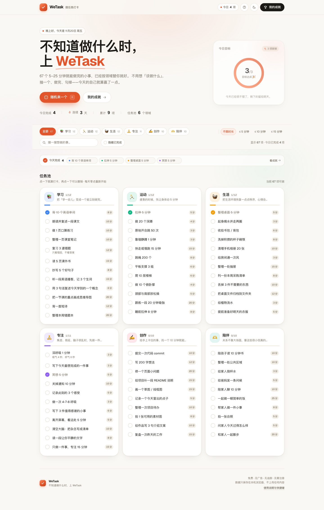
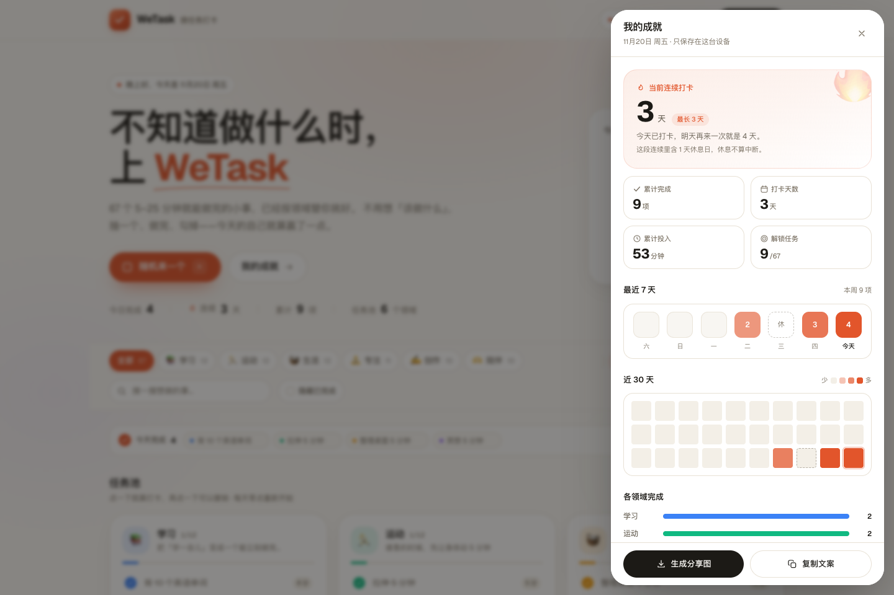
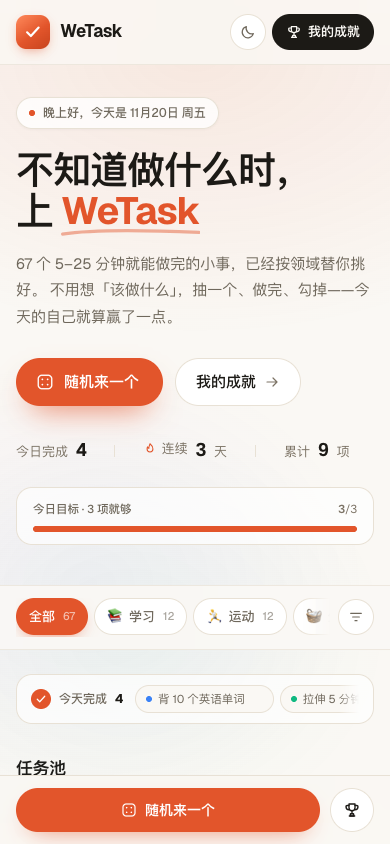
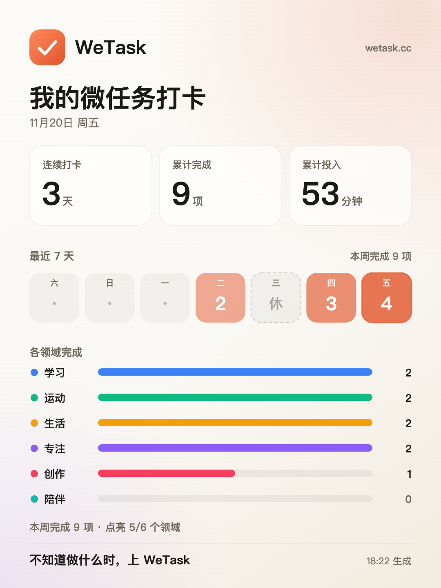

# WeTask · 不知道做什么时，上 WeTask

一个开箱即用的微任务打卡站：**67 个 5–25 分钟就能做完的小事，已经按领域替你挑好。抽一个、做完、勾一下。**

没有「新建任务」，没有复杂的项目管理。你只需要选择和执行两件事，剩下的交给任务池。



- 站点：wetask.cc
- 定位：微任务打卡与激励
- 数据：全部保存在浏览器 localStorage，无后端、无数据库、无账号、无追踪

## 界面

| 首页 | 成就面板 |
| --- | --- |
|  |  |

| 移动端 | 分享图 |
| --- | --- |
|  |  |

## 功能

| 模块 | 说明 |
| --- | --- |
| 任务池 | 6 个领域（学习 / 运动 / 生活 / 专注 / 创作 / 陪伴）共 67 个微任务，每个都标注预计耗时 |
| 随机抽取 | 「随机来一个」从当前筛选范围抽一条，可按领域、按可用时长抽取；抽到不想做的可以换 |
| 打卡 | 点一下即打卡，再点一次撤销；每天零点自动重置，历史记录永久累计 |
| 今日回顾 | 顶部条展示今天完成的所有微任务，可点击撤销 |
| 成就面板 | 连续打卡、累计完成、累计投入、打卡天数、解锁任务、最近 7 天 / 近 30 天热力图、领域分布、徽章 |
| 每周休息日 | 每周允许 1 天「休息日」不中断连续记录，只补前后都打过卡的单个空缺 |
| 离线可用 | 注册 Service Worker，断网也能打开并打卡（数据本来就在本地）；支持安装到桌面 |
| 分享 | 一键生成 1080×1440 分享图（Canvas 绘制），支持保存、复制图片与复制文案 |
| 备份 | 导出 / 导入 JSON，换设备时手动迁移 |
| 其他 | 深色模式、键盘快捷键（`R` 随机、`/` 搜索、`Esc` 关闭）、筛选条件记忆、移动端适配 |

## 设计依据：和竞品比，我们刻意不做什么

| 竞品 | 它的机制 | 我们的取舍 |
| --- | --- | --- |
| Streaks | 错过一天，连续归零 | 太硬。我们允许每周 1 天休息日，但绝不掩盖真正的放弃 |
| Habitica | 漏打卡扣 HP、掉等级 | 惩罚会让人卸载。我们只给正反馈 |
| Loop | 用分数代替链式连续 | 分数不直观。我们用天数 + 休息日，规则一句话说清 |
| Routinery | Rest Mode + 补卡券 | 思路一致，但我们不引入额外状态，休息日由记录推导 |
| Fabulous | 付费教练、课程体系 | 太重。我们的第一原则仍是「打开就能做」 |

依据：2026 年 Scientific Reports 的一项 RCT（N=497）发现，提前规划时间地点、并允许每周 1–2 天跳过日的一组，3 个月和 6 个月后的习惯自动化程度显著更高。这是我们做「每周休息日」的直接原因。

反过来，Routinery 统计的 642 条「太复杂 / 太满」类差评平均只有 2.96 星（整体 3.96 星），说明**加功能是习惯类产品最常见的死法**。所以这一版只补了休息日、离线能力和回来的提示，没有加自定义任务、提醒、社交。

## 技术栈

- **Next.js 16**（App Router + Turbopack + Cache Components）
- **React 19** + **TypeScript**
- **Tailwind CSS v4**（`@theme` 设计令牌，无组件库）
- 纯前端：任务数据随站点发布，打卡记录存在 `localStorage`
- 分享图：原生 Canvas 手绘，不依赖 html2canvas 等第三方库

## 本地运行

```bash
npm install
npm run dev     # http://localhost:3000
npm run build   # 生产构建
npm run start   # 本地预览生产包
npm run lint    # ESLint
```

## 数据结构：一个领域一个文件

微任务清单是**项目的源码**，不经过任何数据库。每个领域一个文件，集中在 `src/data/`：

```
src/data/
├── types.ts      # MicroTask / TaskList 类型
├── index.ts      # 汇总任务池
├── study.ts      # 学习
├── fitness.ts    # 运动
├── life.ts       # 生活
├── focus.ts      # 专注
├── create.ts     # 创作
└── family.ts     # 陪伴
```

单个清单文件的结构：

```ts
export const study: TaskList = {
  id: "study",
  name: "学习",
  short: "学",
  icon: "📚",
  color: "#3B82F6",
  blurb: "把「学一会儿」变成一个能立刻做完的小动作",
  tasks: [
    { id: "study-01", title: "背 10 个英语单词", estMin: 8, hint: "先读三遍，再遮住中文自测" },
    // ...
  ],
};
```

### 新增一个领域

1. 在 `src/data/` 下新建 `reading.ts`，导出一个 `TaskList`；
2. 在 `src/data/index.ts` 里 import 并加入 `taskLists` 数组；
3. 新任务的 `id` 用领域前缀（如 `read-01`），保证全局唯一；
4. `color` 决定该清单的主题色，`blurb` 是卡片副标题。

### 新增一个微任务

直接在对应文件的 `tasks` 数组里追加一条即可：

```ts
{ id: "study-13", title: "读完一篇短文并写 3 句摘要", estMin: 15 }
```

> 建议：动词开头、一次能做完、预计耗时控制在 3–25 分钟。任务是产品的核心资产，宁可少而准。

### 打卡记录

只存一份真相：**每一天完成了哪些任务**。

```json
{
  "version": 1,
  "days": {
    "2026-11-20": ["study-01", "fit-02"]
  }
}
```

累计数、连续天数、每个任务完成过几次、领域分布等，全部由这份数据推导（`src/lib/progress.ts`），避免多份数据不一致。

## 部署

静态部署即可，推荐 Vercel + 自有域名：

```bash
npm i -g vercel
vercel --prod
```

然后在 Vercel 项目里绑定 `wetask.cc`，用 Cloudflare 托管 DNS 即可获得更稳定的国内访问。全站为静态产物，无需环境变量与数据库。

`public/sw.js` 会缓存页面外壳与静态资源：断网时仍可打开已访问过的页面并继续打卡（数据在 localStorage），下次联网自动更新。Service Worker 只在生产环境注册，不影响本地开发。

## 目录结构

```
src/
├── app/                     # 路由、元数据、OG 图、图标、sitemap/robots
├── components/              # 页面组件（首页、清单卡、抽任务、成就、分享）
├── data/                    # 微任务清单（一个领域一个文件）
├── hooks/                   # 打卡状态、主题、持久化
└── lib/                     # 日期、统计、分享图、工具函数
```

## 隐私

- 不注册、不登录、不上传任何内容；
- 打卡数据只写入当前浏览器的 `localStorage`；
- 无广告、无第三方统计脚本；
- 换设备或清缓存前，可在「我的成就 → 数据备份」导出 JSON。

## License

MIT
